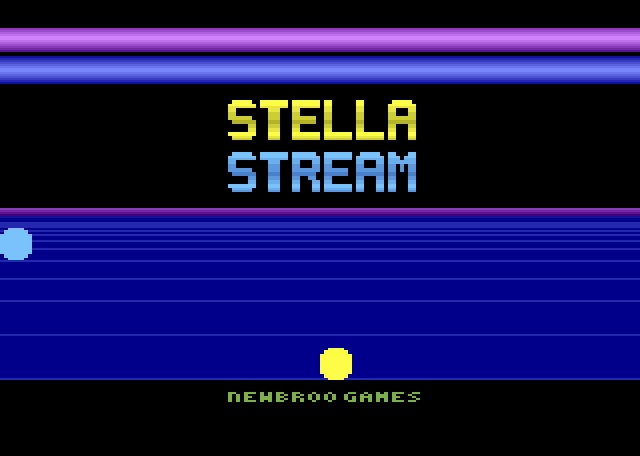
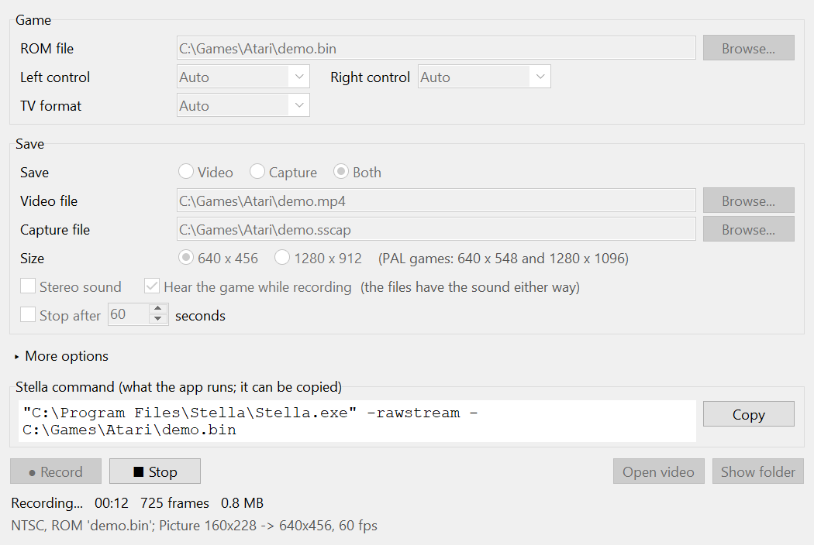

<a href="https://newbroo.com"></a>

# StellaStream

Record Atari 2600 games played in the [Stella](https://stella-emu.github.io/)
emulator to MP4 videos, frame-perfect and with the sound in sync.



*A test ROM made for this page, as StellaStream records it (a GIF here; the
video has the tune too).*

It uses Stella's `-rawstream` option, which hands every emulated frame, audio
sample and the console's RAM, untouched, to an outside program. StellaStream is
one example of what that stream makes possible.

Tested on Windows. The code is plain Python and should work on macOS and
Linux too, but nobody has tried them yet.

## Needs

- Python 3.10 or newer, with tkinter (the python.org installers include it).
  Nothing else to install from pip.
- [ffmpeg](https://ffmpeg.org/), on the PATH or chosen in the window.
- A Stella build with `-rawstream`. Until Stella itself has it, build the
  `rawstream-7.0c` branch of
  [Newbroo-Games/stella](https://github.com/Newbroo-Games/stella/tree/rawstream-7.0c):
  Stella 7.0c plus the option, described in its
  [docs/rawstream.md](https://github.com/Newbroo-Games/stella/blob/rawstream-7.0c/docs/rawstream.md).

StellaStream looks for Stella in this order: the `STELLASTREAM_STELLA`
environment variable, a Stella source checkout built next to this folder
(`../stella`), then Stella on the PATH. The window's Stella program field (under
More options) and the command line's `--stella <path>` override all three.

## Record from the window

```
python stellastream.pyw
```

On Windows, double-clicking `stellastream.pyw` works too.



1. Choose the game's ROM. The video and the capture are named after it and
   saved next to it, until you name them something else.
2. If Stella can't tell, choose the controllers and the TV format (a driving
   game needs Driving, for example).
3. Choose what to save: a **Video**, a **Capture** (the whole stream in a small
   file, see [Capture files](#capture-files)), or **Both**. A capture alone
   needs no ffmpeg and little CPU while you play; make videos from it later.
4. Press **Record** and play in Stella's window. **Stop**, closing Stella, or
   the time limit ends the recording, and the files are finished.
5. **Open video** plays the video; **Show folder** shows where the files are.

Good to know:

- A file is never replaced: if the name is taken, the new one becomes
  `game-2.mp4`, `game-3.mp4`, and so on; a video and capture saved together
  keep the same number.
- Closing the window while recording stops the recording and saves the files
  first.
- With **Hear the game** off, Stella plays silently; the files have the sound
  either way, because it comes from the stream.
- The **Stella command** box shows exactly what the window runs, so you can
  see the option at work, or copy it.
- **More options:** the Stella and ffmpeg programs, extra Stella options, the
  video quality, and keeping the separate picture and sound files.
- Every field is remembered, in `%APPDATA%\StellaStream\settings.json` on
  Windows and `~/.config/StellaStream/settings.json` elsewhere.

## Record from the command line

Record while you play; close Stella to finish the video:

```
python record.py --rom path/to/game.bin game.mp4
```

Options: `--scale 2` for 1280-wide video, `--stereo`, `--seconds 60` to stop
after a minute, `--stella-args="-lc Driving"` for any other Stella options
(here, a driving controller on the left port), `--ffmpeg <path>` if ffmpeg
isn't on the PATH, `--capture game.sscap` to save a capture of the same play
too. Ctrl+C also stops and finishes the video.

Record from a stream saved earlier with `Stella -rawstream capture.raw game.bin`:

```
python record.py capture.raw game.mp4
```

## Capture files

A capture file (`.sscap`) keeps the whole stream (every frame, every sound
sample, the RAM) packed in one-second blocks: in our tests about 300 times
smaller than the raw stream, some 7 KB a second or 25 MB an hour. Make videos
from it whenever you like.

Save one while you play; close Stella to finish:

```
python sscap.py --rom path/to/game.bin game.sscap
```

Make a video from it:

```
python record.py game.sscap game.mp4
```

Pack a raw stream, unpack a capture again, or check one (`-v`: a line per
block):

```
python sscap.py capture.raw game.sscap
python sscap.py game.sscap capture.raw
python sscap.py game.sscap -v
```

The format is described in [docs/capture-format.md](docs/capture-format.md).

## Check a stream

Check a stream, and print RAM bytes every frame (addresses, or names from a
DASM `.sym` file):

```
python rawstream.py --rom path/to/game.bin --frames 300 --watch Frame,$b6 --sym game.sym
```

## Tests

```
python -m unittest discover -s tests -t .
```

The tests build their own tiny 2600 ROM (`tests/testrom.py`), run Stella on it
silently with a settings folder of their own, and check the stream, the RAM
against the picture, the videos, and capture files (a round trip byte for
byte, damaged files, the format spec's own decoder). The window's tests build it hidden, on a
settings file of their own, and record that ROM from it. Without Stella or
ffmpeg those tests are skipped.

## License

MIT; see [LICENSE](LICENSE). The Newbroo Games name and logo are not covered
by it.
